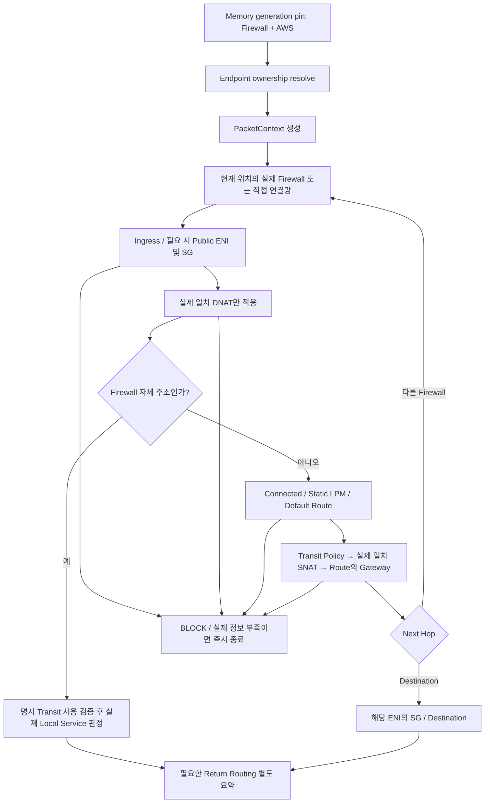

# Firewall Path Analysis: Dynamic Packet Flow

후속 변경: [Published Address / Index / 일일 수집](firewall-published-index-daily.md). 아래 초기 구현의 Interface/Alias 즉시 Local 종료 정책은 폐기되었으며, 현재는 명시 Transit/NAT 사용을 먼저 검증하고 실제 Local Service 근거가 있을 때만 Local Endpoint를 사용한다.

## 변경 전 조사

`POST /api/firewall/path-check` → `FirewallPathCheckService.check()` → `PathAnalysis.analyze()` → `_check_legacy()` → `enhance()` 흐름이었다. `_check_legacy()`가 `determine_firewall_path()`/`NETWORK_MAPPINGS`로 Firewall 목록과 예상 Zone을 먼저 생성했다. `enhance()`는 그 목록에 대해 Policy, Route, SNAT, Gateway, Return Route를 일괄 평가하고, `progress()`가 이미 계산한 후속 결과를 NOT_REACHED로 바꿨다. 따라서 차단 후에도 실제 계산이 실행되었다. Route/NAT/기존 matcher가 서로 별도로 Interface를 추론했다.

Frontend의 Full Progress는 Backend 노드를 사용했지만 Mini Path 및 Source/Destination Only 상세는 Route/NAT/Gateway를 필터링했다. 고정 경로 생성의 주 원인은 Backend였다.

기존 Export Parser(`firewall_rule_export`, `firewall_nat`, `firewall_routes`, `firewall_network_export`), Snapshot Refresh API, Scheduler 연결, atomic JSON helper는 재사용한다. 운영 IP/이름/관리 포트를 제품 코드에 추가하지 않는다. 외부 API나 패킷 probe로 운영 검증하지 않았다.

## 실행 구조



미래 Step을 만들어 채우지 않는다. `DynamicPathBuilder.emit()`은 실제 평가된 processing만 추가한다. Forward BLOCK/UNKNOWN에서는 다음 Hop, NAT, SG, Return을 계산하지 않는다. Source/Destination 노드는 이 Event 목록에만 결합한다.

## 요청한 32개 보고 항목

| 번호 | 결과 |
|---|---|
| 1 | 고정 Path: 삭제한 `_check_legacy()` 및 기존 `PathAnalysis.enhance()`의 사전 Firewall 목록 순회/Return 누적. |
| 2 | `_check_legacy()` 호출 및 구현 제거. `enhance()`는 공통 Dynamic Builder를 호출한다. 예전 Mapping 함수는 다른 소비자 호환성을 위해 남기며 새 엔진에서는 경로 배열 생성에 사용하지 않는다. |
| 3 | `PacketContext`: original/current Source·Destination, Protocol/Port/번호, location/firewall, ingress/egress/zone, route/gateway, 적용 DNAT/SNAT, hop 원본 Destination/Port, visited state/firewalls, hop count, Forward 상태, Destination Type, FQDN 의미를 보관한다. |
| 4 | `DynamicPathBuilder`: Endpoint → 첫 Hop → `hop()` 반복 → 실제 Event 추가. 최대 64 Hop 및 반복 state 감지. 직접 Connected Segment/동일 VPC는 Gateway Firewall을 통과시키지 않는다. |
| 5 | 정확한 Firewall Primary/Alias/Public ownership → AWS Public/Private → Connected Site → 기존 Mapping seed → External/Unknown 순서. FQDN 입력은 기존 Snapshot DNS 결과로만 concrete address별 분석한다. AWS Instance/ENI ID는 Endpoint metadata에 보관한다. |
| 6 | 명시 Gateway 소유 Firewall 우선. VPN은 원격 Destination Route와 reciprocal Source VPN Route로 유일하게 식별한 peer만 사용하고 INFERRED 근거를 남긴다. 다중 후보/불명확한 peer는 UNKNOWN. 외부 WAN은 실제 소유 Public ENI로 계속 진행하거나 일반 Internet에서 끝난다. |
| 7 | 자체 주소 우선, Physical Connected 및 Static LPM, 동등 prefix는 Connected 우선, static administrative distance, default 순서. 명시 default가 없어도 WAN Interface와 Gateway의 실제 설정으로 default를 구성한다. Alias는 독립 Connected Link를 만들지 않는다. Blackhole 차단, 동등한 서로 다른 next hop은 UNKNOWN. |
| 8 | 기존 Parser/Index와 `decide_policy()`/`match_rules()` 재사용. Enabled, API order, Source/Destination Zone/Object, Service, Protocol/Port를 비교한다. OR 목록의 확정 매칭이 있으면 다른 FQDN/누락 Object가 오염시키지 않는다. 유효한 선행 Rule의 unresolved 조건은 여전히 보수적으로 판정한다. |
| 9 | DNAT: 실제 Original Source/Destination/Service 및 Inbound/Outbound selector 전체 검증. 변환 후 Destination/Port를 Context에 반영하고 이후 Route/Policy가 이를 사용한다. 변환 주소/서비스를 단일하게 결정할 수 없으면 중단한다. |
| 10 | SNAT: 선택된 Egress Interface를 같은 Context에서 재사용한다. 해당 Hop 진입 당시 Destination/Port와 현재 Source, 실제 매칭 정책/Linked Rule를 비교한다. MASQ는 해당 Interface IP만 사용한다. |
| 11 | DNAT/SNAT은 실제 Rule 매칭 및 변환 성공 시에만 Event 생성. VPN/LAN에서 NAT가 적용되지 않으면 NAT Event 없음. NAT 정의 자체가 수집 실패한 경우에는 NAT 없음으로 추정하지 않고 Configuration 부족으로 중단한다. |
| 12 | `TopologyIndex.aws_addresses/public_addresses`는 ENI의 각 PrivateIpAddresses.Association 및 DescribeAddresses의 정확한 ENI/Private IP 쌍을 사용한다. 한 ENI의 다른 EIP를 Primary IP에 잘못 연결하지 않는다. |
| 13 | AWS Private IP와 Sophos Physical/Alias IP를 exact join. Alias는 Parent Interface 및 Zone을 상속한다. 서로 다른 VPC/ENI에서 Private IP가 중복되면 소유 관계를 임의 선택하지 않는다. |
| 14 | `#`는 경로용 NAT lookup 및 `_networks()`에서 Interface/Alias reference로 해석한다. Export에 쓰이는 원래 문자열/공통 Parser는 변경하지 않는다. |
| 15 | 자신의 Interface/Alias도 명시 Transit/NAT 정책을 먼저 검사한다. 실제 Local Service 근거가 있는 경우에만 Local Endpoint로 분류하고, 자료가 없으면 Endpoint 용도 미확정으로 남긴다. 관리 포트는 하드코딩하지 않는다. |
| 16 | Source Outbound, 실제 도착 Public ENI, 최종 AWS Destination의 exact attached SG만 검사한다. SG가 막으면 후속 경로를 생성하지 않는다. 다른 VPC를 사이트명/같은 주소 범위로 직접 연결하지 않는다. |
| 17 | Destination 도달, BLOCK, 필요한 정보 부족, routing loop, hop limit에서 종료. 차단 시 마지막 Destination만 NOT_REACHED로 표시하고 미래 processing은 만들지 않는다. |
| 18 | Forward가 도달한 뒤 실제 통과 Firewall Hop의 역순 Routing/비대칭만 평가한다. Stateful 응답에 신규 Inbound Policy를 재평가하지 않는다. Return은 별도 `returnPath`; Progress에 Return Route를 미리 넣지 않는다. |
| 19 | 필요한 Snapshot/주소·서비스 Object/Zone·Interface 누락, 관련 DNS 미확정, 동등 Route/NAT 순서 모호, 실제 Next Hop/VPN 연결 부족, 미수집 AWS Transit/Local ACL, loop/limit 등이 실제 멈춘 지점의 UNKNOWN 사유다. 무관한 FQDN/사용하지 않은 장비의 stale 상태는 현재 흐름을 오염시키지 않는다. |
| 20 | Full/Mini/Vertical은 Backend Event/Progress의 순서를 사용한다. Mini/Source Only 상세의 고정 타입 필터를 제거했다. 기존 Panel/Badge/layout을 유지하고 필요한 Return Summary만 표시한다. |
| 21 | Policy Discovery로 나온 Source/Destination 범위가 `analyze()` → 동일 Dynamic Builder를 호출한다. Network/Service/FQDN partition 결과와 정책 provenance를 유지한다. |
| 22 | Snapshot/Index/Topology/AWS를 동일 lock에서 pin. 일반 분석에는 Firewall/AWS API, 실시간 DNS, AWS 파일 재읽기 없음. Refresh에서만 Network Inventory를 수집하고 새 Join을 생성한다. |
| 23 | 추가 AWS 원본과 Rule Resolved 교차 확인으로 기존 3개 NAT Object를 정상 Resolve했다. 대상 ENI 및 SG 10개를 식별하고 Seoul VPN을 거쳐 Cloud까지 평가한다. 남은 중단 원인은 선행 RDS FQDN 정책의 구체적인 DNS 주소 미제공이다. 자세한 실제 결과는 `firewall-provided-data-validation.md` 참고. |
| 24 | 추가 AWS 원본으로 Public EIP → 실제 WAN ENI → Private IP → Cloud PortB/WAN을 Join했다. SG 2개와 TCP/4430 조건도 확인했다. 남은 중단 원인은 Seoul 선행 Country/FQDN 정책의 주소 구성원 미제공이며 Mapping 실패가 아니다. |
| 25 | Synthetic Primary/Alias EIP, Parent/Zone 상속, 각 EIP의 정확한 private pair, 중복 private 주소 모호성 자동 테스트. 제공 자료의 실제 Join 확인 범위는 아래 표 참고. |
| 26 | Synthetic Alias `#reference` → 실제 DNAT → translated Route/Policy → Server 흐름 자동 테스트 통과. Source/Service/양 Interface 불일치에서는 DNAT 미생성. |
| 27 | 일반 Internet: Site → default WAN route → 실제 SNAT → 선택된 Gateway. 다른 Cloud Firewall/VPN/SG/Return Step 없음. |
| 28 | `tests/test_firewall_dynamic_packet.py`에서 정상/차단/loop/limit/동일 Subnet/VPC, FQDN, EIP/Alias, NAT, refresh atomicity/세대 pin, transport 없는 분석 및 Chromium UI를 검증한다. |
| 29 | 최종 로컬 테스트 결과는 아래 검증 결과에 기록한다. 운영 API 테스트 없음. |
| 30 | Self Review: Return 실패와 Forward 미도달 혼동, 같은 Subnet에서 불필요한 Firewall Transit, 다중 VPC private 중복 Join, FQDN 혼합 family 처리, generation 불일치 시 최신 AWS fallback으로 혼합할 가능성을 발견했다. |
| 31 | Forward/Return 상태 분리, 직접 Connected 처리, 2-pass unique Join 및 ambiguity 유지, 혼합 family 결과 보존, manifest version mismatch에서 AWS Join 거부를 추가하고 회귀 테스트를 재실행했다. SG evidence에 실제 매칭 Rule을 유지했다. |
| 32 | 공통 Export Parser와 Workbook 생성 코드는 변경하지 않는다. Firewall Rule/NAT/Route/Interface/Zone/Gateway Export 회귀 테스트를 실행한다. |

## Refresh / 저장 / 안전한 실패

- 기존 `/api/firewall/configuration/refresh`와 `/status`, Scheduler 인터페이스를 유지한다.
- `AwsCollector.collect_network()`는 기존 EC2 read API 7종만 사용한다: Instances, ENIs, Addresses, SGs, SG Rules, Subnets, VPCs. SSM/InstanceTypes/Volumes/Excel은 호출하지 않는다.
- AWS Credential 미설정이면 기존 수집 Cache로 Join할 수 있으며, Firewall 최초 Snapshot 생성을 막지 않는다. Credential을 설정한 환경에서 AWS 조회가 실패해도 Firewall API 수집은 진행하지만 새 결합 세대는 공개하지 않는다.
- 기존 Firewall별 검증/atomic save/Index 생성 뒤, 결합 Topology를 검증·저장하고 Firewall Snapshot/Index/AWS/Topology를 한 번에 Memory에 공개한다.
- `cache/firewall_config/topology.json`은 `snapshot_ids` 및 결합에 사용한 AWS network snapshot을 보관한다. `cache/aws.json` 구조를 바꾸지 않는다.
- 결합 세대 실패 시 기존 Memory와 이전 Firewall JSON을 유지/복구한다. 재시작 시 manifest 버전 불일치는 조용히 최신 AWS와 섞지 않는다. 기존 pre-topology Cache는 최초 로드에만 이관한다.
- 로그는 stage, Firewall, endpoint type, Route type, Ingress/Egress Zone·Interface, 결정 상태/코드 중심이다. XML, 인증정보, 전체 예외 원문을 추가하지 않는다.

## 제공 자료의 검증 한계와 실행 방법

첨부 Workbook에는 Cloud 225 / Seoul 196 / Icheon 50 / Anseong 43개의 Rule과 NAT·Route·Interface·Zone·Gateway 시트를 확인했다. 이 자료는 **Parser가 이미 Export한 결과**이며, 원본 API XML, 모든 NAT Object/Service 정의, AWS ENI/SG Cache의 대체물이 아니다. 표시명에 들어간 IP를 Object 주소로 추정하지 않았다.

추가 검증에서 `250827_Forti(IN)` 정책에 3개 VIP Object의 실제 주소가 있음을 확인했다. 기존 오프라인 loader의 다중 Object 처리 누락을 수정했다. 해당 참조를 원본 누락이라고 보고한 이전 판단은 정정한다. 최신 실제 데이터 결과와 구체적으로 남은 미확정 predicate는 [추가 검증 보고서](firewall-provided-data-validation.md)에 정리했다.

오프라인 재현 도구는 추가 Python dependency 없이 XLSX를 읽는다:

```bash
python tools/validate_firewall_packet_workbook.py WORKBOOK.xlsx \
  --source SOURCE_IP --destination DESTINATION_IP --protocol TCP --port PORT
# 포트 옵션 생략 = ANY. 이미 수집한 AWS Cache를 사용할 경우 --aws-json LOCAL_AWS_JSON
```

이 도구는 원본 파일을 변경하지 않으며, 임시 디렉터리에서 분석하고 API/DNS를 호출하지 않는다. 모든 실제 주소/질의는 인자로 받는다. AWS 원본은 추가 제공되어 검증했다. 최종 경로는 실제로 미제공인 선행 정책의 DNS 주소/그룹 구성원에서만 미확정으로 남는다. 개별 SG의 Prefix List CIDR도 제공되지 않은 경우에만 미확정이다.

## 변경 파일

- `backend/services/firewall_packet.py`: PacketContext, Builder, Return Analyzer.
- `backend/services/firewall_topology.py`: Endpoint/Interface/Alias/AWS Join, Route/Next Hop.
- `backend/services/firewall_path_analysis.py`: 동적 엔진 연결, 같은 Network/Service/FQDN/Discovery 재사용.
- `backend/services/firewall_path_check.py`: 기존 고정 실행 제거, pin된 Configuration metadata.
- `backend/services/firewall_configuration.py`: 결합 Topology 저장/로드/atomic 공개.
- `backend/services/aws_assets.py`: 기존 EC2 network-only 수집 재사용 진입점.
- `frontend/src/pages/FirewallPathCheckPage.tsx`: 동적 목록 전체 렌더링, 별도 Return 요약.
- `tools/validate_firewall_packet_workbook.py`: 첨부 Export 기반 오프라인 검증.
- Firewall 관련 테스트: 고정 Step/후속 평가/실시간 DNS 기대를 제거하고 실제 경로·Cache generation을 검증.

커밋·푸시는 하지 않는다. 새 runtime dependency는 없다.

### 첨부 자료의 Interface / Route 확인(오프라인)

| 제공 값 | Excel에서 확인한 관계 |
|---|---|
| `10.30.1.201` | Cloud `PortB` / Parent `PortB` / WAN / Physical |
| `10.30.1.212` | Cloud `PortB:10` / Parent `PortB` / WAN / Alias |
| `100.1.2.131`의 Seoul Route | Static `100.1.0.0/16` / `xfrm3` / VPN |
| `3.38.46.51`의 Seoul Route | Default `0.0.0.0/0` / `Port2` / WAN / Interface의 `ISP_Gateway` 설정 |

위 Sophos/Route 결과에 추가 AWS 원본을 Join하여 실제 ENI ID/SG 및 EIP 연결도 검증했다. 최신 상세 결과는 추가 검증 보고서 참고.

## 최종 검증 결과

- 전체 로컬 테스트: **1,231 passed / 2 failed**, 87.83초. 변경된 Firewall/SG/Discovery/Refresh/Chromium 및 기존 Sophos Export 회귀는 통과했다.
- 신규 Dynamic Packet 테스트: **31개 케이스**(브라우저 3개 포함), 전체 실행에서 모두 통과.
- 기존 실패 2개: `tests/test_settings_service.py::test_scheduler_runs_every_target_then_index` 및 `tests/test_timeline_export.py::test_search_all_is_not_limited_by_timeline_group_item_cap`. 이번 변경 전에도 보고된 Scheduler Index 인터페이스/Timeline 항목 수 제한 문제이며 수정 범위에서 제외했다.
- Frontend `npm run build`, `npm run typecheck` 통과. `git diff --check` 통과.
- Raw XML/API Parser 및 Excel Export 생성 코드는 수정하지 않았다. SSM 수집/Document/Cache Inventory 구조를 변경하지 않았다.
- 운영 Firewall/AWS/DNS로 확인한 결과가 아니다. 실제 데이터에 대한 판단 범위와 누락된 근거는 위의 오프라인 검증 항목을 따른다.
