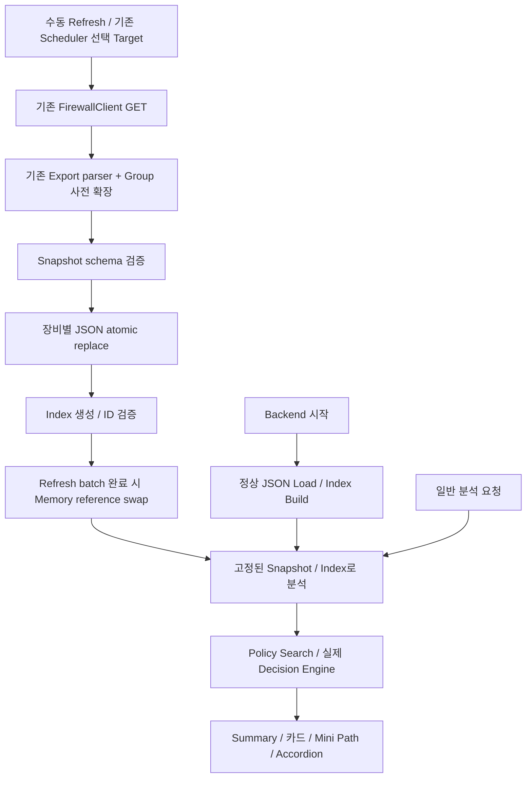

# Firewall Path Analysis — 정책 검색, Snapshot/Index, NAT 및 카드 UI

현행 Alias 판정, Index 검색 및 하루 1회 Configuration 수집 정책은 [후속 보고](firewall-published-index-daily.md)를 따른다. 아래는 초기 구현 기록이다.

두 요청과 추가 UI 참고 이미지를 함께 반영한 현재 구현 보고다. 운영 방화벽/AWS 호출은 하지 않았으며, 실제 장비 대신 mock 응답·로컬 Cache·브라우저 fixture로 검증했다. 커밋/푸시는 하지 않았다.

## 변경 파일

| 구분 | 파일 |
|---|---|
| Backend | `backend/services/firewall_configuration.py` (신규), `firewall_path_check.py`, `firewall_path_analysis.py`, `firewall_path_decisions.py`, `settings.py`, `backend/app.py` |
| Frontend | `frontend/src/pages/FirewallPathCheckPage.tsx`, `ConfigPage.tsx`, `frontend/src/App.tsx`, `frontend/src/styles.css` |
| 신규 테스트 | `tests/test_firewall_configuration.py`, `test_firewall_path_cached_analysis.py`, `test_firewall_policy_cards_browser.py` |
| 기존 회귀 테스트 | `test_firewall_path_analysis.py`, `test_firewall_path_decisions.py`, `test_firewall_path_analysis_browser.py`, `test_firewall_path_layout_browser.py`, `test_firewall_path_check_frontend.py`, `test_firewall_source_fqdn.py`, `test_firewall_path_check.py`, `test_aws_security_group_path.py` |
| 문서 | 본 문서, 이전 구현 보고서의 현행 보고 링크 |

공통 Firewall Export XML parser, Excel 출력, AWS/SSM Collector, Launcher/Health/Watchdog/Easy Query는 수정하지 않았다. 추가 Python/Frontend dependency도 없다.

## 1. 수집과 검색의 분리



일반 `/api/firewall/path-check` 요청의 `refresh=false`는 TTL 만료나 Snapshot 부재를 이유로 장비 API를 호출하지 않는다. Snapshot이 없으면 부족한 데이터를 설명한다. 정상 Snapshot의 Index는 요청마다 재생성하지 않으며, 그룹 재귀 확장도 반복하지 않는다.

기존 소비처의 명시적 `refresh=true`는 호환용 강제 Refresh 요청으로 유지하지만, 새 UI는 별도 Refresh API만 사용한다. 일반 분석과 최신화 버튼의 동작은 분리되어 있다.

## 2. Collector와 공통 parser

기존 `FirewallClient.get_rules_compatible()` 및 GET entity allowlist를 재사용한다. Rule, IPHost/Group, FQDNHost/Group, Services/ServiceGroup, NATRule, UnicastRoute, Interface, Alias, Zone, GatewayConfiguration을 수집한다. Rule의 firmware 호환 fallback 이외에는 entity별 중복 조회가 없다. 새 XML entity parser는 만들지 않았다. Object/Service 원시 필드는 기존 Export helper로 읽고, 그 위에서 Group 관계를 재귀 확장한다.

기존 FirewallClient의 단일 요청 timeout은 60초로 bounded되어 있다. 정상 분석은 이 timeout 경로를 타지 않는다. 무한 API retry는 추가하지 않았다.

## 3. Persistent Snapshot

설정된 장비 이름을 소문자 파일명으로 사용한다.

```text
cache/firewall_config/cloud.json
cache/firewall_config/seoul.json
cache/firewall_config/icheon.json
cache/firewall_config/anseong.json
cache/firewall_config/status.json
```

장비 파일은 `rules/natRules/routes/interfaces/aliases/zones/gateways`, 정규화된 `objects/services/fqdnObjects`, 원본 Group 관계와 확장 결과, 수집 시 해석된 FQDN 주소를 저장한다. Credential, 원본 API XML, 전체 exception message는 저장하지 않는다.

```json
{
  "metadata": {
    "schema_version": 1,
    "snapshot_id": "<generated-id>",
    "firewall": "<configured-name>",
    "refreshed_at": "<ISO timestamp>",
    "source": "sophos_configuration_api"
  },
  "rules": [],
  "natRules": [],
  "routes": [],
  "interfaces": [],
  "aliases": [],
  "zones": [],
  "gateways": [],
  "objects": {},
  "services": {},
  "fqdnObjects": {}
}
```

이는 필드 설명용 축약 예시다. 실제로 모든 정보가 빈 Snapshot은 정상 결과로 받아들이지 않는다. `status.json`에는 장비별 last attempt, last successful refresh, 성공/실패, 안전한 error code/type/entity만 보관한다.

## 4. Validation / Atomic / 실패 보존

- 응답 XML과 Response root, API status를 검증한다. 잘린 XML, 알려진 pagination/next-token/total-count 불일치는 거부한다.
- 필수 entity 실패, 테이블/필드 타입 오류, Rule 이름 누락/중복, 잘못된 metadata, Snapshot/Index ID 불일치를 거부한다.
- 모든 테이블이 빈 결과를 거부한다. 기존 Rule이 있는데 API가 total=0을 명시하지 않은 빈 Rule 결과로 바꾸는 것도 거부한다.
- API 수집 → Parsing → Validation → 기존 `RefreshService.save_json_atomic()`으로 Snapshot 저장 → Index 생성 → Memory 교체 순서로 실행한다. 저장 후 Index 생성에 실패하면 이전 JSON으로 복구하며, 최초 수집이면 새 파일을 제거한다.
- 실패한 장비의 기존 JSON/Memory Snapshot/Index는 유지한다. 성공한 장비만 새 후보를 준비한다.
- 장비별 수집이 끝날 때마다 Memory를 노출하지 않는다. batch 전체 종료 시 성공 후보와 실패 장비의 기존 데이터를 한 번에 공개한다.
- 각 분석 요청은 하나의 고정된 Memory view를 사용한다. Refresh 중에도 이전 Index로 검색할 수 있다.
- 재시작 시 정상 Snapshot을 검증하여 Index를 미리 만든다. 손상 파일은 분석에 사용하지 않는다.

API가 총 레코드 수나 pagination 정보를 제공하지 않으면 서버 측의 조용한 누락을 완전히 증명할 수는 없다. 확인 가능한 partial 신호와 빈 결과 보호를 적용하며, pagination을 임의 추측해 추가 요청하지 않는다.

## 5. Search Index

IP prefix별 dictionary/set으로 Host/CIDR 포함 후보를 찾는다. Host 단일 검색은 주소 공간을 열거하지 않고 저장된 prefix별 lookup을 수행한다. 넓은 CIDR은 겹치는 prefix bucket을 검색한다.

Index에는 다음 관계가 있다.

- IP/CIDR → Object, Source Rule, Destination Rule, Any Rule
- Object → 상위 Group, Object/Group → Rule
- Service/ServiceGroup → Rule 및 Group 관계
- NAT Original Source/Destination, Translated Source/Destination → NAT 후보
- Route prefix → Route 후보, Interface → Zone/Gateway, Alias → Parent Interface
- 주소 분할용 경계와 순서가 복원된 Rule

중첩 Object/Service Group은 수집 때 memoized DFS로 확장하고 cycle을 방어한다. 누락 참조는 알려진 주소로 임의 보정하지 않는다. 이름 안의 숫자를 임의 IP로 사용하지 않도록 정규화한다. FQDN Object의 주소도 수집 시 저장하며, 같은 FQDN 입력은 그 주소를 재사용한다. 새 사용자 FQDN은 기존 bounded DNS resolver를 사용할 수 있다.

Index는 후보 검색 도구다. 최종 적용 여부는 활성 상태, Zone, 주소, 서비스, 우선순위 및 실제 경로로 다시 평가한다. 레거시 API 응답을 만드는 경로도 Index를 사용하여 전체 Rule의 중복 순회를 줄였다.

## 6. Source Only / Destination Only 정책 검색

Source Only는 Source index, Destination Only는 Destination index에서 직접 IP, Host, 포함 CIDR, Group, Any 정책을 찾는다. 처음부터 임의 Site 목록을 만들지 않는다. NAT Original/Translated 관계로 관련 주소를 찾고, 내부 Destination은 공개 DNAT 주소를 통한 경로도 검증한다.

검색한 Rule의 실제 이름, Firewall, Action, Service, Snapshot ID를 `relatedPolicies`에 남긴다. Grouping 후에도 `policyCount`와 Rule 이름이 사라지지 않는다. 같은 Object/범위는 묶고 실제 Path Engine으로 각 범위를 검증한다. Source Only/Destination Only의 기존 mode 값은 유지하며 `analysisMode`에 SOURCE_ONLY/DESTINATION_ONLY 명칭을 추가했다.

완전한 Snapshot에서 관련 정책이 없으면 기본 Drop 기준의 BLOCK을 반환한다. Snapshot/API/참조 Object가 실제로 부족하면 UNKNOWN과 구체적 이유를 반환한다.

## 7. Port / Rule / Route / SG

빈 Port는 TCP/ANY 또는 UDP/ANY다. 서비스 경계별 판정을 유지하고 Any Service Drop은 Port 없이도 확정 BLOCK이다. 서로 다른 ServiceGroup member의 Protocol과 Port를 섞지 않는다. 기존 숫자 우선순위 또는 검증된 Top/After chain으로 적용 Rule을 선택한다.

Connected/Static LPM, Distance, Interface/Alias Zone, Gateway 설정, Return Route 및 기존 cache 기반 AWS SG 검사는 유지한다. Rule/Route 등에서 최초 BLOCK 이후 단계는 NOT_REACHED다. 후단 UNKNOWN이 BLOCK을 덮지 않는다. 단일 AWS Endpoint를 특정할 수 없는 범위나 미수집 Cloud routing은 기존 SG helper의 제약에 따라 설명을 반환한다.

## 8. NAT Match와 Default SNAT 오탐 방지

Original Source/Destination/Service와 실제 Inbound/Outbound Interface를 모두 검사한다. Interface/Zone을 Rule 이름에서 추측하지 않는다. Route가 xfrm이면 실제 xfrm 이름을 비교하므로 WAN Port 전용 Default SNAT은 내부 VPN 흐름에서 reject된다. Omitted optional selector는 제한 없는 조건으로 처리하며, 존재하는 selector를 무시하지 않는다.

SNAT과 DNAT 모두 selector 전체가 맞고 실제 변환을 계산했을 때만 Step을 만든다. DNAT 후 목적지/서비스는 정책과 Route에 반영하고, SNAT은 Route 뒤에서 반영한다. linked Rule 조건과 NAT 우선순위도 사용한다. 적용 후보만 있거나 MASQ의 실제 Egress IP가 없을 때 원본→원본의 가짜 Translation을 표시하지 않는다.

내부 상태는 `NAT_NOT_REQUIRED`, `NAT_NO_MATCH`, `NAT_APPLIED`, `NAT_UNKNOWN` 의미를 구분한다. 호환용 기존 `natStatus`와 신규 `natDecision`을 함께 제공한다. NAT 없음은 정상일 수 있으며 UI에는 Step을 만들지 않는다. 데이터 획득/필수 참조가 부족하면 NAT_UNKNOWN finding으로 설명한다. Source Translation이 불명확한 상태로 후속 Source Rule/SG를 확정하지 않는다.

## 9. 요청한 VPN 시나리오

사용자가 지정한 Source/Destination/TCP ANY를 mock Configuration으로 재현했다.

```text
Source
→ Seoul Firewall PASS
→ Static 100.1.0.0/16, xfrm3 / VPN
→ Cloud Firewall (실제 우선순위의 Drop Rule)
→ 후단 NOT_REACHED
```

WAN Port selector를 가진 Default SNAT IPv4는 이 경로에서 완전히 제외된다. 운영 장비로 접속해 같은 결과라고 주장하지 않으며, 실제 Rule 이름/Action은 운영 Snapshot에 따라 결정된다.

## 10. API / UI Refresh / Scheduler

| 동작 | 처리 |
|---|---|
| 일반 분석 | 기존 `/api/firewall/path-check`, refresh=false, 로컬 Snapshot/Index만 사용 |
| 최신화 시작 | `POST /api/firewall/configuration/refresh`, 202, 중복 실행 공유 |
| 진행 상태 | `GET /api/firewall/configuration/status`, Memory 상태만 반환 |
| 최신화 완료 | 새 batch 공개 → 현재 입력으로 다시 분석 |
| 자동 최신화 | 기존 Scheduler의 `firewall_configuration` 선택 Target, 사용자가 저장한 Interval 적용 |

Refresh 중에는 Refresh 버튼만 잠기고 일반 분석 버튼은 사용할 수 있다. 완료 시 최초 클릭 당시의 낡은 입력이 아니라 현재 Query를 재실행한다. UI의 Configuration 기준 시각은 검색 시각이 아닌 Snapshot의 실제 성공 수집 시각이다. 여러 장비의 기준일은 응답에 각각 제공하며 상단은 보수적으로 가장 오래된 시각을 표시한다. Refresh 실패 후에는 이전 정상 Snapshot 사용을 경고하고 원래 BLOCK 결론은 유지한다.

## 11. 참고 이미지 기반 UI

Sidebar/Page/Breadcrumb를 Firewall Path Analysis로 맞추고 기존 URL은 유지했다. 기존 SMU Panel/Button/Badge/Token을 사용하며 전역 Background/Sidebar layout/theme를 바꾸지 않았다. 예시 IP, 회사명, Rule, 건수를 UI에 심지 않았다.

Source/Destination Only는 다음 구조다.

1. 분석 유형, Query, 관련 정책 수, 총 건수·허용·차단·주의 집계
2. 전체/허용/차단/주의 가로 Filter
3. 대상 정보 → Mini Path → 상태 Badge → 화살표 순서의 compact 카드
4. 한 카드만 여는 Accordion
5. 확장 영역 왼쪽 numbered Vertical Stepper, 오른쪽 최종 판단/차단 지점/Rule/Action/구간/사유

데스크톱에서는 허용→차단→주의 순서로 배열하고, 작은 화면에서는 Mini Path와 판단 영역을 안전하게 줄바꿈한다. 차단 이후 link는 점선/비활성이다. 혼합 결과의 Mini Path를 전체 PASS처럼 표시하지 않는다. 같은 Network 구간 전체가 동일 경로/판정이면 불필요한 조각 선택을 합친다. FQDN 복수 IP의 결과가 다르면 개별 IP 결과를 선택할 수 있다.

Raw Table/XML/JSON, Candidate Rule 표, 모두 펼치기/접기는 없다. 필요 시 선택 Rule의 짧은 근거와 관련 정책 이름만 펼친다. PATH는 하나의 Summary/Progress/Stepper를 유지한다.

## 12. 성능 계측

응답 `metrics`와 Debug log에 normalize/policy lookup/NAT match/route match/path decision/total ms를 남긴다. Credential이나 원문 exception은 넣지 않는다.

1,001 Rule synthetic Snapshot, 모드별 5회 로컬 반복의 관측값은 다음과 같다. flaky한 시간 SLA assert는 넣지 않았다.

| 모드 | 평균 검색 | 수집 stub + Snapshot/Index 준비 | 검색 중 Firewall API |
|---|---:|---:|---:|
| PATH | 1.480 ms | 69.454 ms | 0 |
| SOURCE_ONLY | 6.711 ms | 73.205 ms | 0 |
| DESTINATION_ONLY | 6.452 ms | 64.573 ms | 0 |

네트워크 지연을 포함한 운영 전후 배수 측정은 아니다. 이전 구조의 cold/expired cache는 장비별 Configuration 요청을 기다렸고, 현재 일반 검색은 항상 0회다. 테스트는 검색 중 API, Group 재확장, 정상 Index 재생성이 발생하면 실패하도록 검증한다.

## 13. Self Review에서 발견하여 고친 항목

| 발견 | 수정/검증 |
|---|---|
| xfrm Interface가 물리 Interface 표에 없으면 SNAT selector를 미확정 후보로 취급 | 실제 Route interface 이름을 비교하고 불일치 Rule은 제외 |
| 한쪽 Interface만 검사할 수 있던 NAT 경로 | Inbound와 Outbound 모두 검사, DNAT의 변환 후 Egress 계산 |
| MASQ 정보 부재 시 identity Translation 같은 Step | 적용 Step 생성 금지, NAT_UNKNOWN finding 및 후속 Source 판정 보호 |
| 레거시 응답 생성 경로가 전체 Rule을 재순회 | 같은 pinned Index 후보 사용 |
| 요청마다 Index/Group 경계를 다시 만들 가능성 | 정상 Memory Index 재사용 및 사전 경계/서비스 분할 memo |
| 잘린/부분/빈/손상 Snapshot 처리 | Response/metadata/type/count 검증과 이전 정상 데이터 보존 |
| Refresh 진행 중 일부 장비만 먼저 Memory에 보일 가능성 | batch 종료 시 한 번에 공개, 두 장비 동시성 테스트 |
| 입력 수정 뒤 Refresh 완료가 이전 Query를 재실행할 가능성 | 최신 run reference 사용, 브라우저에서 현재 입력 재실행 검증 |
| Policy 0건을 모두 UNKNOWN으로 표시 | 정상 데이터면 기본 Drop, 누락 참조면 정확한 UNKNOWN |
| Screenshot에서 Filter가 큰 세로 버튼이 됨 | 좁은 폭에서도 wrap되는 가로 Filter로 보정 |
| FQDN/Network 동일 결과의 불필요한 분할 또는 혼합 결과 미표시 | 동일 판정 통합, 범위/IP 선택, Warning Mini Path |
| 실패 최신화의 기준 시각/상태 혼동 | 성공 Snapshot 시각 고정, 실패 status 보존 및 stale 경고 |

1440/1024/390px의 5개 결과 카드(허용 3/차단 1/주의 1)와 확장 화면을 fixture로 캡처해 제공 이미지와 구조를 비교했다. Browser test는 Filter, 한 Accordion, Mini Path, 오른쪽 사유 Panel, 넘침, 빈 입력, Refresh 중 검색을 검증한다.

## 14. 남는 한계와 UNKNOWN 조건

실제 Snapshot 부재/API 실패, 누락/순환/미해석 참조나 DNS 실패, 필요한 Interface/변환 주소 부족, Connected/Static에 없는 동적 Route, 미수집 AWS routing 또는 단일 식별이 불가능한 SG Endpoint 등은 구체적 사유와 함께 UNKNOWN이 될 수 있다. Gateway의 runtime Up/Down을 임의 판정하지 않는다.

NAT pool/복잡한 다중 변환, 동적 routing 전체, 실시간 연결성을 보장하는 기능은 아니다. 기존 Network/FQDN 조합·서비스 구간·그룹 수 예산을 유지하며 미분석 범위를 전체 PASS로 표시하지 않는다. API가 제공하지 않는 pagination 증거를 만들거나 운영 서버를 probe하지 않는다.

## 15. 검증 결과

최종 전체 실행 결과는 아래에 기록한다. 공통 Export parser와 XLSX 출력은 수정하지 않았으며 전체 회귀에 포함한다. 기존 API 필드는 유지하고 configuration/metrics/relatedPolicies/policyCount/miniPath 등 분석 필드를 추가했다. 정상 Snapshot으로 직접 분석한 결과와 Persistent Snapshot 분석의 동일성도 검증했다.

### 최종 로컬 실행 결과

- 신규 검증 **60 passed**: Snapshot/Index/동시성/로드 **30**, NAT·정책검색·성능·Scheduler **24**, 참고 이미지 기반 카드/Refresh/FQDN 브라우저 **6**.
- 전체 pytest: **1194 passed, 2 failed**, **81.31초**. 변경 전부터 동일한 두 실패만 남았다.
  - `tests/test_settings_service.py::test_scheduler_runs_every_target_then_index`: 기존 ScheduledIndex.mode 계약 불일치.
  - `tests/test_timeline_export.py::test_search_all_is_not_limited_by_timeline_group_item_cap`: 기존 150/100건 제한 불일치.
- Frontend `typecheck` 및 production `build`: 성공. 기존 bundle 크기 경고만 존재.
- Normal PATH / Source Only / Destination Only의 Firewall Configuration API **0회** 검증.
- 검색 중 정상 Index 재생성/Group 재확장 **0회** 검증.
- Snapshot/Index 고정 view, batch 종료 후 교체, 실패 시 이전 데이터 보존 및 재시작 로드 검증.
- 기존 Firewall/NAT/Route/Interface/Zone/Gateway Export, AWS SG 및 Path API 회귀에서 신규 실패 없음.
- `git diff --check`: 통과. 새 dependency 없음. 운영 장비/API/probe 호출 및 커밋·푸시 미실행.

처음 설치하거나 기존 Snapshot이 없는 경우에는 **최신 정보 다시 조회**를 한 번 실행해야 한다. 자동 Refresh는 Config의 기존 Scheduler에서 Firewall Configuration을 선택하고 원하는 Interval로 저장한다. 실패 장비는 이전 정상 Snapshot이 유지되고 Configuration 기준 시각도 새 검색 시각으로 위장하지 않는다.

최종 재실행(전체 검증 후 NAT 상태 enum 도달 경로까지 확인): **1194 passed, 2 failed**, **81.31초**. 신규 60개 테스트의 수집 개수도 별도로 확인했다. 결과가 동일한 기존 두 실패 이외의 회귀는 발견하지 못했다. 코드 수정은 작업 트리에 남겼으며 HEAD는 이전 `fb0da4f` 그대로다.

## 14. Snapshot이 없는 환경의 최초 Refresh

기존 `GET /api/firewall/configuration`은 공개 장비 설정 목록 API다. 동일 경로에 Refresh 상태 API도 등록되어 있어, UI가 목록 응답의 누락된 `running`을 완료로 해석하고 수집 완료 전에 재분석할 수 있었다. 상태 조회를 `/api/firewall/configuration/status`로 분리하고 boolean `running`을 검증한다. 기존 설정 목록 API는 유지한다.

Refresh Collector는 Snapshot-only guard를 사용하지 않고 각 장비 API를 직접 조회한다. 일반 분석은 계속 로컬 Snapshot/Memory Index만 사용한다. Refresh 완료 후 현재 Query를 재분석하며, 실패한 Firewall/Entity의 안전한 진단을 화면 오류와 상태 응답에 제공한다. 진단에는 firewall/entity/stage/exception_type/http_status/api_code/reason만 포함하며, URL·응답 원문·인증정보·전체 예외 문구는 기록하지 않는다. 설정 누락과 설정 로드 실패도 장비별로 보고한다.

`tests/test_firewall_configuration_bootstrap.py`는 Snapshot 파일이 없는 임시 환경에서 실제 Refresh 버튼 → FastAPI → 기존 Collector → 파일 저장 → Index → 재분석 경로를 검증한다. HTTPS 전송만 mock하며 4대 장비의 13개 Entity 호출과 4개 Snapshot 생성을 확인한다. HTTP 403/API 529 진단은 mock 검증값이며 운영 실패 원인을 단정하지 않는다. 운영 API 호출은 수행하지 않았다.
